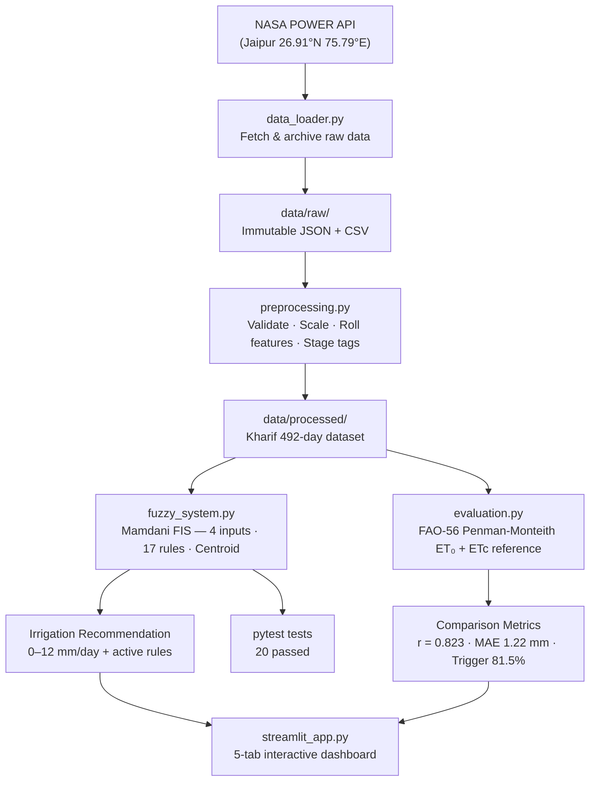

# Smart Irrigation Recommendation System
## Mamdani Fuzzy Inference System for Pearl Millet (*Bajra*) Cultivation — Jaipur District, Rajasthan

[](#5-testing)
[](https://python.org)
[](LICENSE)

---
<div align="center">

# Smart Irrigation Recommendation System

### Pearl Millet Cultivation · Jaipur, Rajasthan

[**Launch Live Application**](https://smart-irrigation-fuzzy.onrender.com)

[](https://smart-irrigation-fuzzy.onrender.com)
[](https://www.python.org/)
[](https://streamlit.io/)

</div>

---

## 1. Overview & Motivation

Smallholder pearl millet farmers in semi-arid Rajasthan face a critical challenge: sandy loam soils drain rapidly, monsoon rainfall is erratic, and temperatures regularly exceed 40°C during the crop's most moisture-sensitive flowering stage. Too little water during booting and grain filling causes 40–60% yield loss; too much during early germination promotes root disease.

This project provides an **interpretable, data-driven irrigation advisory tool** built on a **Mamdani Fuzzy Inference System (FIS)**. Unlike black-box ML models or rigid threshold rules, the fuzzy system:

* Recommends daily net irrigation depth (0–12 mm/day) based on four real environmental inputs.
* Exposes every IF–THEN rule that fired and its premise activation strength.
* Draws on four years of real NASA POWER satellite-reanalysis weather data for Jaipur.
* Compares its recommendations against the internationally recognised **FAO-56 Penman-Monteith** crop water requirement reference.

> **Scope:** This is a decision-support prototype for educational and research purposes. It is not a field-validated irrigation controller. No water savings or yield improvements are claimed without supporting field trial data.

---

## 2. Problem Statement

**How much water does a pearl millet crop in Jaipur district need on a given day**, given the current root-zone soil moisture, ambient temperature, humidity, and antecedent rainfall?

The answer depends on multiple interacting factors with fuzzy boundaries — "moderately dry soil" combined with "hot and dry weather" is meaningfully different from the same soil moisture under "cool and humid" monsoon overcast. Crisp threshold rules cannot represent this interaction gracefully; fuzzy logic does.

---

## 3. Key Features

| Feature | Detail |
|---|---|
| **Algorithm** | Mamdani Fuzzy Inference System with Centroid defuzzification |
| **Inputs** | Root-zone soil moisture, temperature, relative humidity, 3-day rainfall |
| **Output** | Net daily irrigation requirement (0–12 mm/day), 4 linguistic categories |
| **Rules** | 17 agronomic IF–THEN rules |
| **Explainability** | Real-time rule activation display with α-cut strengths |
| **Reference benchmark** | FAO-56 Penman-Monteith ETc (Allen et al., 1998) |
| **Data source** | NASA POWER Daily API — verified, no fabricated observations |
| **Dashboard** | Interactive 5-tab Streamlit UI |
| **Tests** | 20 automated pytest tests across FIS logic, data pipeline, and evaluation |

---

## 4. Architecture & Workflow



---

## 5. Dataset & Source Attribution

| Variable | NASA Code | Unit | Physical Model |
|---|---|---|---|
| Root-Zone Soil Wetness (proxy) | `GWETROOT` | fraction 0–1 | MERRA-2 Catchment LSM |
| Mean Temperature | `T2M` | °C | MERRA-2 reanalysis |
| Max Temperature | `T2M_MAX` | °C | MERRA-2 reanalysis |
| Min Temperature | `T2M_MIN` | °C | MERRA-2 reanalysis |
| Relative Humidity | `RH2M` | % | MERRA-2 reanalysis |
| Wind Speed | `WS2M` | m/s | MERRA-2 reanalysis |
| Solar Radiation | `ALLSKY_SFC_SW_DWN` | MJ/m²/day | CERES / GEOS-FP |
| Precipitation | `PRECTOTCORR` | mm/day | GPCP / MERRA-2 |

* **Coordinates:** Lat 26.9124°N, Lon 75.7873°E — Jaipur District, Rajasthan
* **Period:** 2021-06-01 to 2024-10-31 (1,249 days; 492 Kharif season days)
* **Missing data:** 0 missing records detected
* **API:** https://power.larc.nasa.gov/

> **Soil moisture caveat:** `GWETROOT` is a land surface model output at 0.5° × 0.625° grid resolution — not an in-situ sensor.

---

## 6. Fuzzy Input & Output Variables

| Variable | Range | Linguistic Terms | MF Types |
|---|---|---|---|
| Root-Zone Soil Moisture | 0–100% | Dry, Moderate, Wet | trapmf / trimf |
| Daily Mean Temperature | 15–48°C | Cool, Moderate, Hot | trapmf / trimf |
| Relative Humidity | 10–100% | Low, Moderate, High | trapmf / trimf |
| 3-Day Cumulative Rainfall | 0–60 mm | Low, Moderate, High | trapmf / trimf |
| **Irrigation Requirement** (output) | **0–12 mm/day** | None, Low, Medium, High | trapmf / trimf |

---

## 7. Rule Base Summary (17 Rules)

Rules follow agronomic logic grounded in FAO-56 pearl millet water requirements:

* **Wet soil or heavy rain** → `None` (risk of leaching on sandy loam)
* **Dry soil + hot/dry conditions** → `High` (emergency drought response)
* **Moderate soil + low rain + moderate temperature** → `Medium` (standard mid-season replenishment)
* **Post-rain drydown under moderate soil** → `Low` to `Medium`

Full rule table with agronomic rationale: [`docs/methodology.md`](docs/methodology.md)

---

## 8. Evaluation Methodology & Verified Results

Reference model: **FAO-56 Penman-Monteith ET₀** (Allen et al., 1998, Equation 6), implementing:
- Full $R_n$ calculation from solar radiation, clear-sky estimate, and Stefan-Boltzmann longwave
- Actual vapour pressure from relative humidity
- Psychrometric constant from Jaipur elevation (435 m a.s.l.)
- Stage-specific pearl millet Kc values from FAO-56 Table 12

| Metric | Mamdani FIS | Fixed Threshold Baseline |
|---|:---:|:---:|
| Pearson Correlation $r$ | **0.823** | 0.309 |
| MAE (mm/day) | **1.217** | 1.478 |
| RMSE (mm/day) | **1.537** | 2.465 |
| Trigger Agreement | **81.5%** | — |
| Mean active rules/day | 2.05 | — |

> **Interpretation:** Metrics measure correlation with a crop water demand equation — not field-validated water savings or yield outcomes.

---

## 9. Installation

```bash
# Clone the repository
git clone https://github.com/Aryan-Singh-Rajawat/smart-irrigation-fuzzy.git
cd smart-irrigation-fuzzy

# Install dependencies
pip install -r requirements.txt
```

**Requirements:** Python 3.10+, numpy, pandas, scipy, scikit-fuzzy, matplotlib, streamlit, requests, pytest.

---

## 10. Download Historical Data

The raw NASA POWER dataset is excluded from version control (>1 MB). Fetch it with:

```bash
python src/data_loader.py
```

This downloads and archives 1,249 daily records (2021–2024) for Jaipur to `data/raw/`.

Then run preprocessing:

```bash
python src/preprocessing.py
```

And the evaluation pipeline:

```bash
python src/evaluation.py
```

---

## 11. Run the Tests

```bash
python -m pytest tests/ -v
```

Expected output: **20 passed** across `test_fuzzy_system.py`, `test_preprocessing.py`, and `test_evaluation.py`.

---

## 12. Launch the Dashboard

```bash
python -m streamlit run app/streamlit_app.py
```

Open `http://localhost:8501`. The dashboard includes five tabs:
1. **Interactive Simulator** — real-time sliders, centroid defuzzification plot, active rule table
2. **Historical Jaipur Records** — browse 492 real Kharif days with FIS vs FAO-56 overlay
3. **Membership Functions** — visual plots of all fuzzy sets
4. **Evaluation & Metrics** — verified benchmark comparison and 3D sensitivity surface
5. **Scientific Governance** — data provenance, assumptions, and limitations

---

## 13. Project Structure

```
smart-irrigation-fuzzy/
├── data/
│   ├── raw/                       # Immutable NASA POWER downloads (gitignored if large)
│   └── processed/                 # Cleaned datasets and evaluation outputs
├── docs/
│   ├── data_sources.md            # Verified data provenance register
│   ├── methodology.md             # Membership functions, rules, FAO-56 equations
│   ├── project_report.md          # Academic project report
│   └── viva_notes.md              # Exam preparation Q&A
├── src/
│   ├── data_loader.py             # NASA POWER API downloader
│   ├── preprocessing.py          # Cleaning, scaling, rolling features, stage tags
│   ├── fuzzy_system.py            # Mamdani FIS with scikit-fuzzy
│   └── evaluation.py              # FAO-56 PM reference, baseline, sensitivity
├── app/
│   └── streamlit_app.py           # Interactive dashboard
├── tests/
│   ├── test_fuzzy_system.py       # 10 logic and boundary tests
│   ├── test_preprocessing.py      # 5 pipeline tests
│   └── test_evaluation.py         # 5 reference model tests
├── requirements.txt
└── README.md
```

---

## 14. Limitations & Scientific Caveats

1. **Soil moisture is a proxy:** `GWETROOT` is derived from a land surface model, not an in-situ sensor.
2. **Advisory prototype:** Not an automated actuator; field use requires agronomist review.
3. **No field trial evidence:** Correlation with a reference equation ≠ measured water savings or yield improvement.
4. **Spatial resolution:** 0.5° × 0.625° NASA POWER grid — not farm-specific.
5. **Generic crop coefficients:** FAO-56 Table 12 values; local cultivar calibration may be needed.
